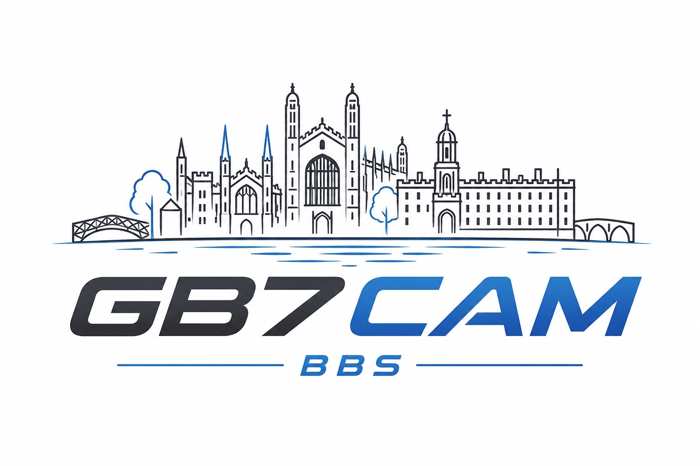

## Services Available

This node runs a LINBPQ and combines Node, BBS, Mail and Chat Services as well as a few games and a system monitor tool.

### Requirements

First you require an amateur radio license.  This is essential!

Second you must configure your radio to transmit and receive packets using a software TNC such as Direwolf or a hardware TNC such as NinoTNC.  Using Direwolf is a great starting point and can be used with usb soundcards such as DigiRig.  There are many [guides](https://themodernham.com/ultimate-direwolf-tnc-installation-guide-for-windows-and-linux/) online to set this up.

### Node

Once setup, you can connect to the GB7CAM using QTermTCP.  Simply select ```CONNECT``` and enter ``` GB7CAM```

Once connected, the following commands are available:

```
BBS CHAT CLUSTER GAMES SYSMON CONNECT BYE INFO NODES PORTS ROUTES USERS MHEARD
```

- **BBS** enters the Bulletin Board / Mail System
- **CHAT** enters the Chat System
- **CLUSTER** enters the DX cluster, GB7CAM-3
- **GAMES** enters a game selection menu
- **SYSMON** launches a system monitor tool
- **CONNECT <PORT NUM> <NAME OF NODE>** allows you to connect to another linked node using ```CONNECT <PORT> GB7CAM``` (Port 3 for the internet links and Port 1 for RF)
- **BYE** Exits the node or current connection
- **INFO** Displays the node info message
- **NODES** shows list of nodes you can connect to
- **PORTS** show ports available for communication (PORT 1 - RF 2m, PORT 3 - AXUDP, with one AXIP link)
- **ROUTES** shows routes to other nodes
- **MHEARD <PORT NUM>** shows stations heard on the specified port
- **USERS** shows users currently logged in to the node

Further node information can be found via the [linBPQ node page](https://node.gb7cam.org.uk) or advanced information on the [status page](status.qmd)

---

### BBS

To connect to the BBS, first login as above and then type
```
BBS
```
Typing HELP will also then give you a full command list.

- Only licensed amateur radio operators are allowed to set up an account.
- If you have an account you can access your mail via the web using [https://node.gb7cam.org.uk/Webmail](https://node.gb7cam.org.uk/Webmail)
- If you would like mail or bulletins forwarded to your node just let me know.
- The HA of GB7CAM is ```GB7CAM.#22.GBR.EURO``` and you can set this to be your home BBS if you wish.

---


### CHAT

To connect to the BBS, first login as above and then type
```
CHAT
```
Typing /h will also then give you a full command list.

---

### DX Cluster

GB7CAM runs its own DX cluster, **GB7CAM-3**, on DXSpider. There are three ways
to reach it.

**From the node.** Log in as above and type
```
CLUSTER
```

**By telnet**, with your own callsign as the login:
```
cluster.gb7cam.org.uk  port 7373
```

**On the web**, as a read-only view of recent spots, with filters for band, mode
and callsign: [https://cluster.gb7cam.org.uk/dx/](https://cluster.gb7cam.org.uk/dx/)

The web page is read-only by design. Spotting is done from the node or over
telnet, not from a browser.

The cluster is linked to partner nodes in the UK, the Netherlands, Italy and the
United States, so spots posted anywhere on the network arrive here within
seconds. The page also shows a green or red dot for each partner link.

Sysops wanting to link a node are welcome to get in touch. GB7CAM-3 runs
DXSpider v1.57 and is listed in the
[dxcluster.info](https://www.dxcluster.info/telnet/index.php) telnet directory.

---